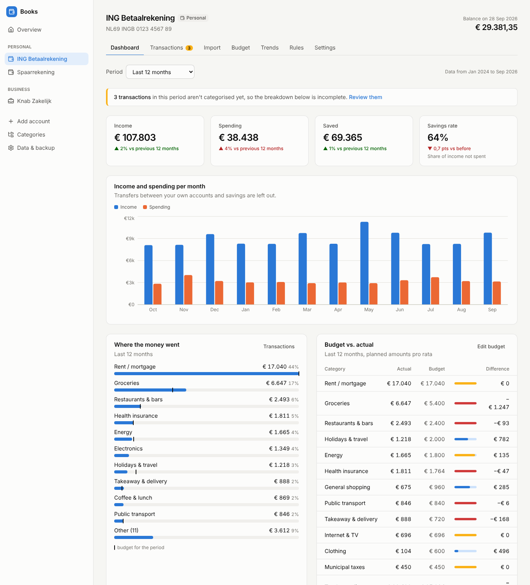
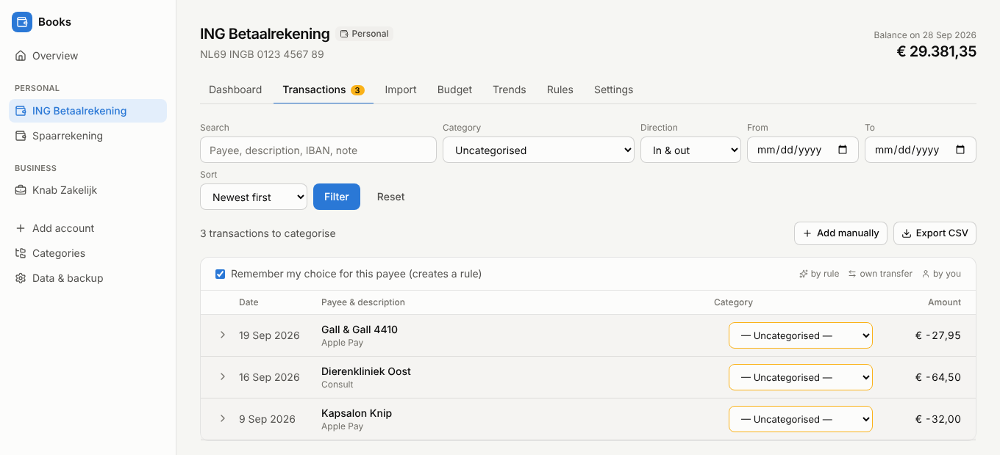
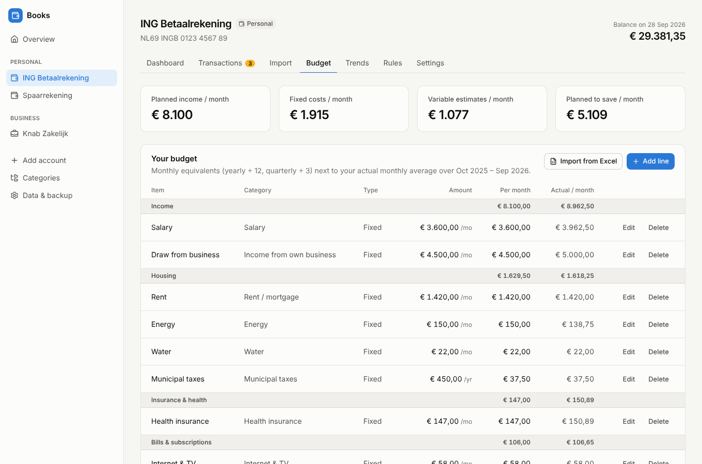
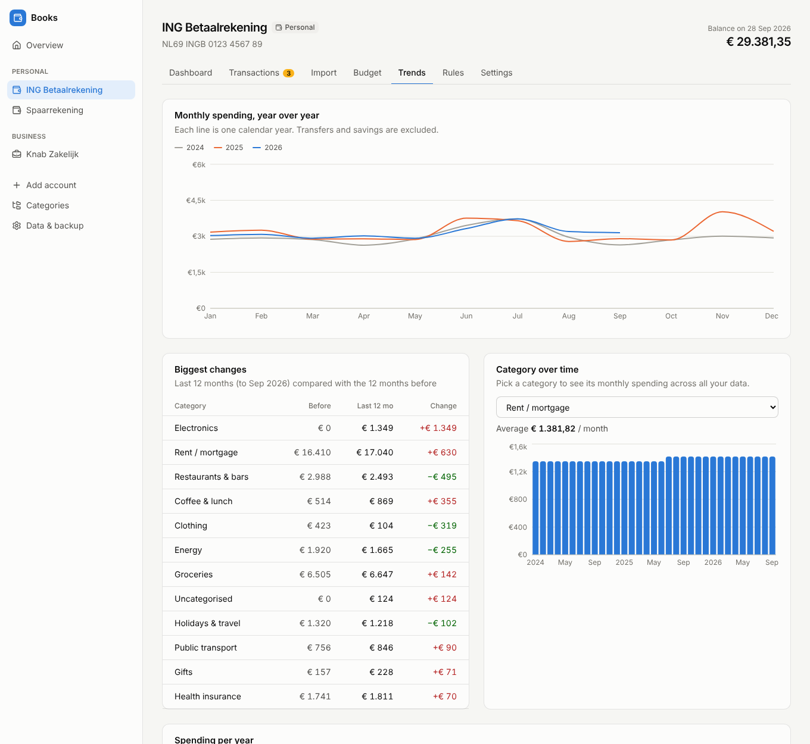
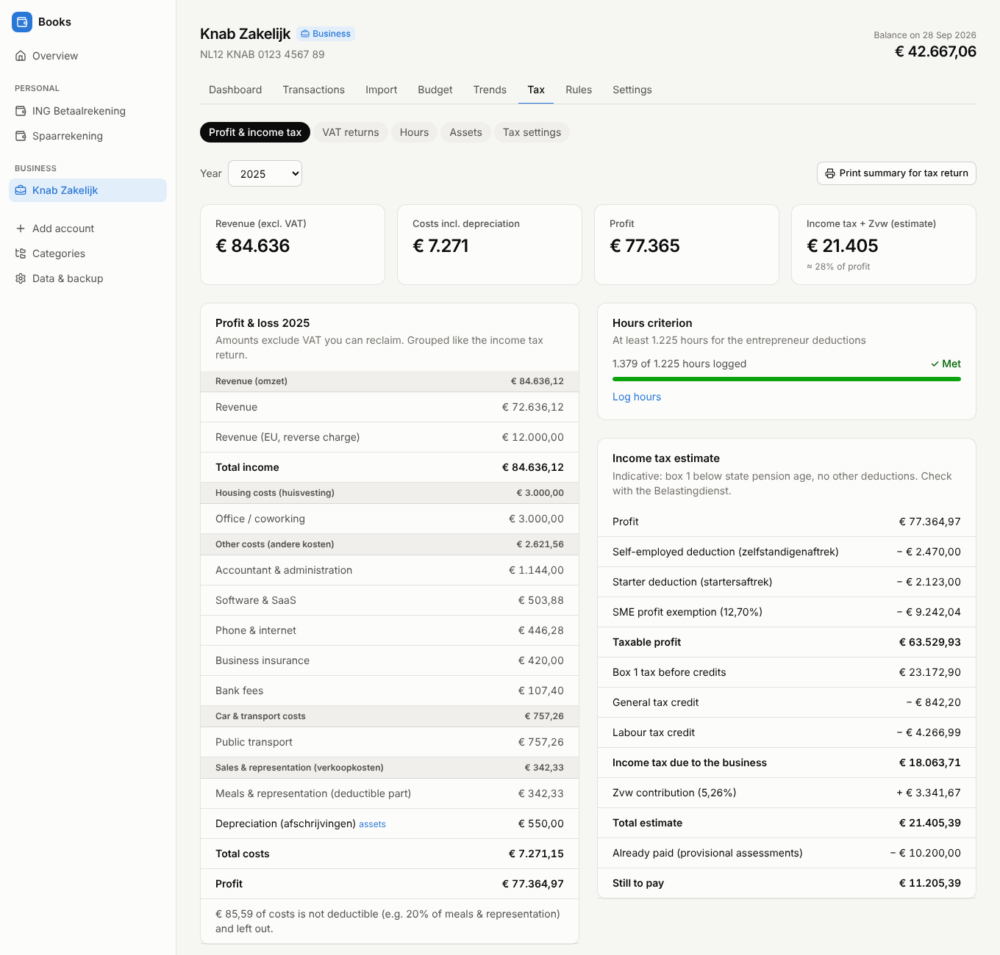

# Books

A private finance dashboard that runs on your own computer. Import your monthly bank exports, let them be
categorised automatically, compare reality with your budget, and see how your spending develops over the
years. Business accounts additionally get Dutch VAT returns, a profit & loss statement, an hours log, asset
depreciation and an indicative income tax estimate.

Everything is stored in **one SQLite file on your machine**. The app listens on `127.0.0.1` only, makes no
outside connections and has Next.js telemetry turned off.



## Quick start

Requires Node.js 20.9 or newer.

```bash
npm install
npm run dev          # http://127.0.0.1:3000
```

Your data goes into `./data/finance.db` (created on first start; git-ignored). Set `FINANCE_DATA_DIR` to keep it
somewhere else, for example on an encrypted disk.

**Want to look around first?** Generate a demo database with 2.5 years of fictional data and run the app on it.
It never touches `./data`:

```bash
npm run demo         # writes ./demo-data/finance.db
npm run dev:demo     # http://127.0.0.1:3001
```

For day-to-day use, `npm run build && npm start` is faster than the dev server.

## The monthly routine

1. **Download** last month's transactions from your bank (see below).
2. **Import** them on the account's *Import* tab. You get a preview first: new transactions, ones already
   imported (skipped automatically, so overlapping periods are fine) and how many were categorised.
3. **Review** the uncategorised ones (the *Transactions* tab shows a badge). Pick a category; with
   *Remember my choice* on, a rule is created so the same payee is recognised next month — and applied to
   other uncategorised transactions right away.
4. **Check** the dashboard: income vs spending, where the money went, budget vs actual, recurring payments.



## Accounts

Create one account per bank account and mark it **personal** or **business**. Accounts that know each other's
IBAN recognise transfers between them: money to your savings account is an internal transfer (left out of
spending), and money from your business account to your personal account is *income from own business* on
one side and a *private withdrawal* on the other.

## Supported bank files

| Bank | File |
| --- | --- |
| ING | CSV (Dutch or English headers) — *Af- en bijschrijvingen downloaden* |
| Rabobank | CSV — *Transacties downloaden* |
| ABN AMRO | TXT (tab-separated) — *Mutaties downloaden* |
| bunq | CSV — *Export statement* |
| Knab | CSV |
| ASN / SNS / RegioBank | CSV |
| Any Dutch bank | **CAMT.053** XML (recommended if your bank offers it) or **MT940** |
| Anything else | Any CSV: map the columns once; the mapping is saved per account |

Balances in the file keep the account balance in sync automatically. Stick to one file format per account:
re-importing in a different format is detected as *likely duplicates* and skipped by default.

## Categories and rules

Categories are grouped (Housing, Daily life, Transport, …) and shared by all accounts of the same type. A
category is *income*, *spending* or a *transfer* (left out of totals). Edit them under **Categories**.

Rules decide categories on import, in this order:

1. transfers between your own accounts;
2. **your rules** — created when you categorise with *remember* on, or by hand on the *Rules* tab;
3. **starter rules** for common Dutch shops and organisations (Albert Heijn, NS, Ziggo, Eneco, Zilveren
   Kruis, …).

Rule conditions are counterparty, description (whole-word matching, ignoring case), IBAN, direction and amount
range. For payment providers such as PayPal or Mollie the learned rule also looks at the description, because
the counterparty name doesn't say who you actually paid. Transactions you categorised by hand are never
changed by rules.

## Budget

Add your fixed costs and estimates per month, quarter or year, each linked to a category — or import them from
your Excel sheet (**Import from Excel** on the *Budget* tab; `.xlsx` or `.csv`). You point out the name and amount
columns, optionally category and frequency columns (Dutch words like *maand*/*jaar* are understood), and check
the suggested categories before anything is saved. Total rows are skipped.

The budget page shows each line's monthly equivalent next to your actual monthly average over the last 12
months, plus categories you spend money on without a budget. The dashboard compares budget and actuals for
any period.



## Trends

The *Trends* tab answers "has my spending gone up or down?":

- monthly spending per year in one chart;
- the biggest changes, last 12 months vs the 12 before;
- every category per calendar year (a running year is compared with the same months of the previous year);
- any category over time;
- **subscriptions and recurring payments**, detected automatically, with price changes since the first payment
  and what they cost per year.



## Business accounts: VAT and income tax

Business categories carry a default VAT treatment (21%, 9%, 0%, exempt, EU reverse charge, outside the EU) and
the section of the profit & loss statement they belong to. Per transaction you can override the VAT rate, enter
the exact VAT amount from the invoice, and set an invoice date when the VAT period differs from the payment
date.

- **VAT returns** per quarter, following the boxes of the Dutch return (1a, 1b, 1e, 3b, 4a, 4b, 5b) with the
  filing deadline. Accounts on the small business scheme (KOR) skip VAT.
- **Profit & loss** per year, excluding reclaimable VAT, with partly deductible costs (e.g. 80% for meals and
  representation).
- **Hours** log for the hours criterion (1,225 hours), with the weekly pace needed.
- **Assets**: straight-line depreciation and the small-scale investment deduction (KIA).
- **Income tax estimate**: zelfstandigenaftrek, startersaftrek, MKB-winstvrijstelling, box 1 brackets, general
  and labour tax credits and the Zvw contribution, minus provisional assessments already paid. Add other income
  (e.g. salary) in the tax settings to get the brackets right.



> The tax figures are an **indication** to help you set money aside and prepare your return — not tax advice.
> Parameters for 2024 and 2025 are built in; 2026 is based on the 2026 tax plan and marked provisional. You can
> correct any parameter per year under *Tax settings*. Box 2/3, mortgage interest, pension deductions, fiscal
> partner allocation and loss carry-forward are not included.

## Privacy and backups

- Data lives in a single file: `data/finance.db` (see *Data & backup* in the app for the exact path).
- *Data & backup* downloads a complete copy and restores one (the current file is kept as a safety copy).
- Each account can export its transactions as CSV.
- The server binds to `127.0.0.1`; there is no login, so don't expose it to a network.
- Keep the data folder on an encrypted disk (FileVault/BitLocker) and in your regular backups.

## How it's built

TypeScript throughout; no Python needed — the JavaScript ecosystem covers everything here (CSV/XML/Excel
parsing, SQLite, charts).

- **Next.js 16** (App Router, server components, server actions), **React 19**, **Tailwind CSS 4**
- **SQLite** via **better-sqlite3** and **Drizzle ORM**; migrations in `drizzle/` run automatically at startup
- **Recharts** for charts, **papaparse**, **fast-xml-parser** and **exceljs** for imports
- **Vitest** for tests

```
src/
  app/                     pages (dashboard, transactions, import, budget, trends, tax, rules, settings)
    actions/               server actions (all mutations)
    api/                   backup download and CSV export
  components/              UI building blocks and charts
  lib/
    db/                    schema, connection, default categories and starter rules
    import/                bank file parsers (CSV presets, CAMT.053, MT940, custom mapping), dedupe
    rules/engine.ts        rule matching, learning, own-transfer detection
    analytics/             totals, budgets, year-over-year, recurring payments
    tax/                   VAT returns, profit & loss, depreciation, KIA, income tax, yearly parameters
    services/              database operations used by pages and actions
scripts/demo.ts            demo data generator
tests/                     parser, rules, analytics, tax and service tests (with sample bank files)
```

### Development

```bash
npm test             # unit and integration tests
npm run typecheck
npm run lint
npm run db:generate  # after changing src/lib/db/schema.ts: creates a migration in drizzle/
```

Money is stored as integer cents and dates as `YYYY-MM-DD` strings. Amounts are shown in Dutch notation.
